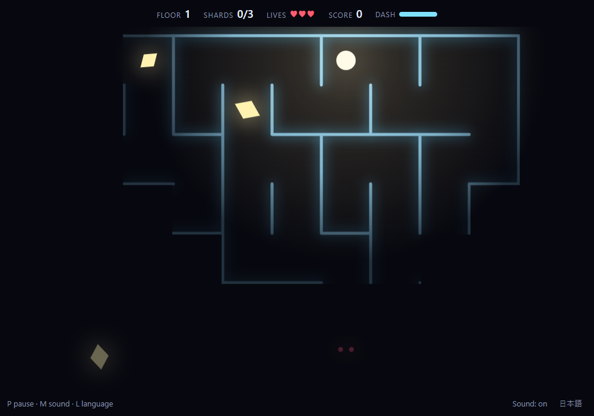
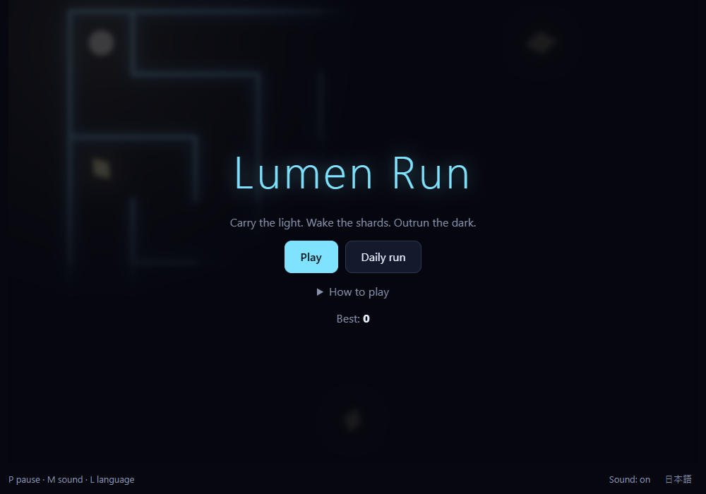

<h1 align="center">Lumen Run</h1>
<p align="center">English: A tiny browser maze game. Carry the light, collect every shard, outrun the shadows.<br>日本語：あかりを抱いて暗い迷路を走るブラウザゲーム。欠片を集めて、影から逃げ切ろう。</p>
<p align="center">
  <a href="https://r38k51.github.io/lumen-run/"></a>
  
  
</p>
<p align="center"><b>English</b> · <a href="#日本語">日本語</a></p>



*Screenshot of the game (floor 1, English UI). / ゲーム画面（1階、英語表示）。*

## English

Play it here: https://r38k51.github.io/lumen-run/

### Features

- Dark mazes lit only by your own light. Every floor is generated from a seed.
- Three kinds of shadows: a chaser, an ambusher that cuts you off, and a wanderer.
- Dash (Space) slips through 3 cells at once, and you cannot be caught meanwhile.
- Floors get bigger and the shadows get faster, then the difficulty levels off so you can go deep.
- Clearing a floor restores one life. Three speed settings (Slow, Normal, Fast).
- English and Japanese UI, sound effects, touch controls (swipe and a dash button).
- One static page: no install, no network requests, no assets.



### Requirements

- A recent browser (Chrome, Edge, Firefox, Safari). Checked in Chromium only; other browsers are not checked yet.
- To run the tests: Node.js 20 or later (checked with Node 22).

### Usage

Open `index.html` in a browser, or serve the folder:

```bash
python -m http.server 8000
```

| Key / action | What it does |
|---|---|
| Arrow keys / WASD / swipe | Move |
| Space / Shift / ⚡ button | Dash |
| P or Esc | Pause |
| M / V / L | Sound / Speed / Language |

Add `?seed=123` to the URL to replay the same maze. "Daily run" uses today's date as the seed.

### Tests

```bash
node --test
```

The tests cover maze connectivity, walls, dash, shards and the gate, getting caught, game over, and seeded replay.

### License

Not decided yet.

---

<a id="日本語"></a>
## 日本語

こちらで遊べます：https://r38k51.github.io/lumen-run/

### 特徴

- 道が見えるのは自分のあかりの範囲だけ。階ごとにシードから迷路を作ります。
- 影は3種類：追いかける影、先回りする影、さまよう影。
- ダッシュ（スペース）で一気に3マス進み、その間は捕まりません。
- 階が進むと迷路が広くなり影も速くなりますが、途中から難しさは頭打ちになり、深くまで潜れます。
- 階をクリアするとライフが1回復します。速さは3段階（ゆっくり、ふつう、はやい）。
- 日本語と英語の表示、効果音、タッチ操作（スワイプとダッシュボタン）。
- 静的な1ページで、インストール、通信、素材は不要です。


### 必要なもの

- 新しめのブラウザ（Chrome、Edge、Firefox、Safari）。確認したのは Chromium だけで、ほかのブラウザは未確認です。
- テストを動かすには Node.js 20 以上（確認は Node 22）。

### 使い方

`index.html` をブラウザで開くか、フォルダを配信します。

```bash
python -m http.server 8000
```

| キー / 操作 | 動作 |
|---|---|
| 矢印キー / WASD / スワイプ | 移動 |
| スペース / Shift / ⚡ ボタン | ダッシュ |
| P または Esc | 一時停止 |
| M / V / L | 音 / 速さ / 言語 |

URL に `?seed=123` を付けると同じ迷路を再現できます。「今日の迷路」は日付がシードです。

### テスト

```bash
node --test
```

迷路がつながること、壁、ダッシュ、欠片と出口、捕まる・ゲームオーバー、シードの再現を確かめます。

### ライセンス

未決です。
